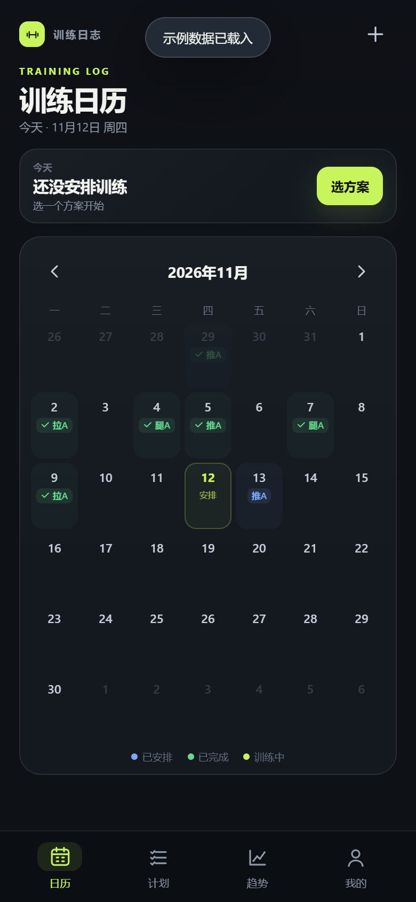
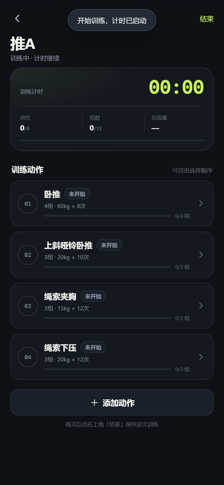
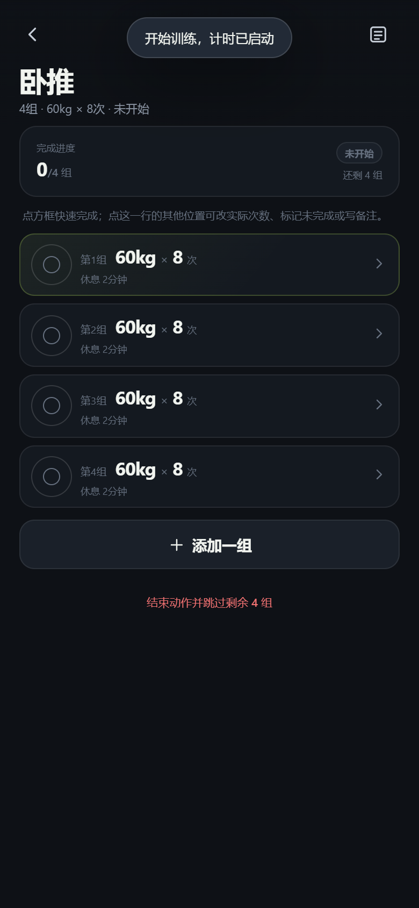
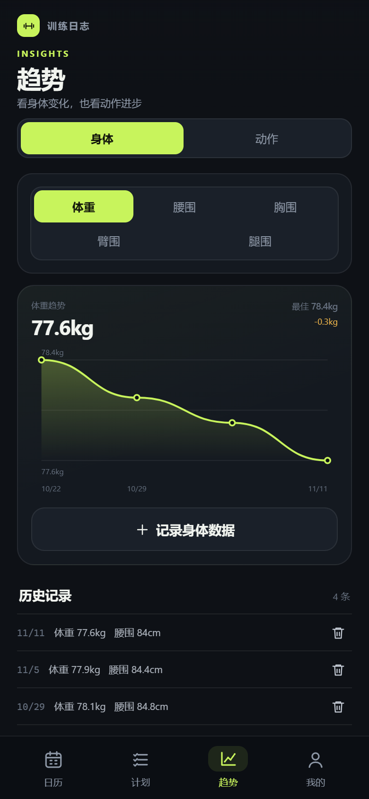

# 训练日志

本地优先的健身计划与训练记录 App。同一套 React 代码同时跑浏览器和 Android。

| 日历 | 训练 | 组记录 | 身体趋势 |
|---|---|---|---|
|  |  |  |  |

## 功能

- 计划模板：每个动作可逐组设置重量、次数、休息秒数，支持统一批量修改
- 排期：把计划排到任意日期，训练实例是计划快照，改模板不影响已排的日期
- 组记录：完成 / 未完成（记实际值）/ 跳过，可写备注和快捷标签
- 休息倒计时：完成后自动开始，系统通知 + 应用内提示音/震动双重兜底
- 趋势：体重腰围等身体数据、动作最大重量/总容量/总次数，自绘 SVG
- 全面屏适配：自定义原生插件读取系统栏 inset，页面按安全区避让
- 备份：导出 JSON，导入时可选合并或覆盖

## 技术栈

| 层 | 选型 |
|---|---|
| UI | React 18 + TypeScript |
| 构建 | Vite 5 |
| 状态 | Zustand 4 + persist（localStorage） |
| 路由 | react-router-dom 6（HashRouter，适配 WebView） |
| 原生桥 | Capacitor 8（LocalNotifications / Filesystem / Share / App / StatusBar） |
| 原生扩展 | 自写 Capacitor 插件（Java），读取状态栏 / 导航栏 / 刘海 inset |
| 测试 | Vitest + Playwright Core |

没有使用 UI 组件库、图标库、图表库。图标为内联 SVG，图表按 360×180 坐标自绘。

## 本地运行

```bash
npm install
npm run dev
```

打开 http://127.0.0.1:8014 。PC 上宽度 ≥600px 时显示为居中的手机框。

首次打开没有数据，可以到「计划」载入示例数据，或直接新建计划。

## Android

已构建并签名 v1.0.1（约 3.52 MB，minSdk 24 / targetSdk 36）。构建链、镜像配置与签名说明见开发文档第 13 节。

真机上的通知权限、锁屏提醒准时性、厂商省电策略仍需实际验证。

## 测试

```bash
npm run typecheck
npm test                          # 11 个领域逻辑单元测试
node scripts/visual-check.mjs     # 截图走查（需先起 dev server）
node scripts/functional-check.mjs # 完整流程回归（需先起 dev server）
```

## 文档

- [开发文档](docs/开发文档.md)：数据模型、业务规则、休息计时的竞态处理、原生插件、构建链、常见坑
- [使用文档](docs/使用文档.md)：逐功能操作说明与截图

## 说明

数据保存在浏览器或 WebView 的 localStorage，无账号、无云同步。卸载 App 或清除站点数据会丢失，需要定期导出备份。PC 版与 APK 的数据不互通，通过导出 / 导入迁移。
