# 训练日志 · 使用文档

> PC 测试版和 Android APK 均已可用。截图里可能包含示例数据或测试提示，实际以你的数据为准。

## 1. 打开 App

双击项目目录下的 `start.bat`，或直接打开：

**<http://127.0.0.1:8014>**

- `start.bat` 会在后台启动服务并打开浏览器；已启动时只打开浏览器。
- 关闭服务：运行 `stop.bat`。
- 电脑上会显示为居中的手机界面；想把窗口缩到手机宽度也可以。

第一次打开没有数据，可以：

1. 点底部「计划」→「载入示例计划」，立刻看到日历、历史和趋势；或
2. 点今天 →「选方案」→「新建计划」，创建自己的计划。

## 1.1 安装 Android APK

APK 位置：

```text
release/WorkoutLog-v1.0.0.apk
```

- 约 3.36 MB，应用名「训练日志」，包名 `com.local.workoutlog`，支持 Android 7.0 及以上。
- 把 APK 传到手机后点击安装；系统提示时允许「安装未知来源应用」。
- 首次训练开始时会请求通知权限，请允许；部分品牌手机还需要允许自启动、关闭省电限制，锁屏休息提醒才稳定。
- APK 使用独立数据，不会自动同步 PC 测试版。若 PC 里已有真实数据：先在 PC「我的 → 导出备份」，装好 APK 后在「我的 → 导入备份」合并或覆盖。
- 签名密钥和密码用于后续升级，必须保留：本地的 `.jks` 签名文件和 `android/keystore.properties`。

---

## 2. 创建训练计划

入口：底部「计划」→ 右上角「+」，或日历右上角「+」。

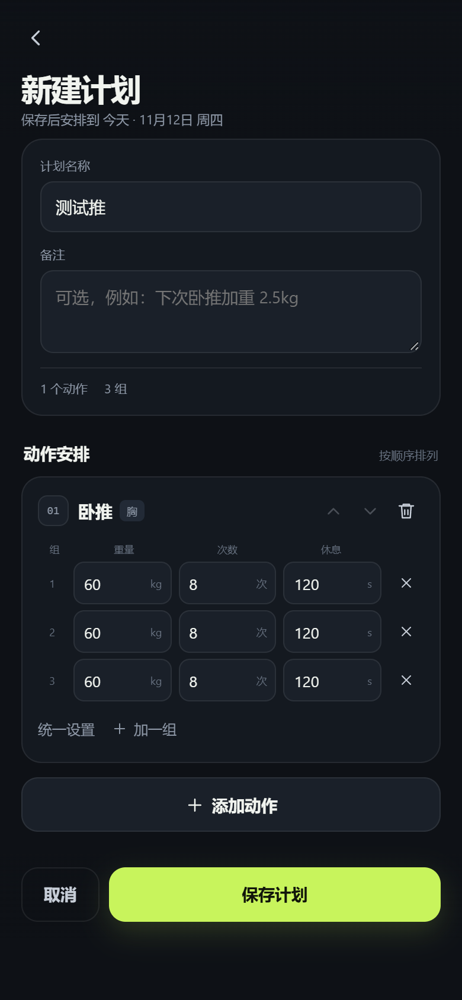

1. 填计划名称，例如 `拉A`、`腿A`、`推A`。
2. 点「添加动作」，可以：
   - 搜索动作（卧推、引体向上、面拉等）
   - 按胸/背/腿/肩/手臂/核心筛选
   - 新建自定义动作
3. 每个动作默认 3 组，可以逐组填写：
   - 重量：留空 = 自重
   - 次数
   - 组间休息（秒）
4. 点「统一设置」可以一次填好所有组的重量/次数/休息，再对个别组微调。
5. 可以「加一组」、删除组、上移/下移动作、删除动作。
6. 点底部「保存计划」。

> 计划模板保存后，后面排到日历的训练是**快照**。再改模板，不会改已经排好的日期。

---

## 3. 把计划排到某一天

### 今天训练

1. 在日历页点今天，或点今天条上的「选方案」。
2. 选择一个计划（例如「拉A」）。
3. 进入「确认今天的训练」。
4. 可以修改每组的重量/次数，或点「统一修改」一次改全部。
5. 点「保存并开始训练」。

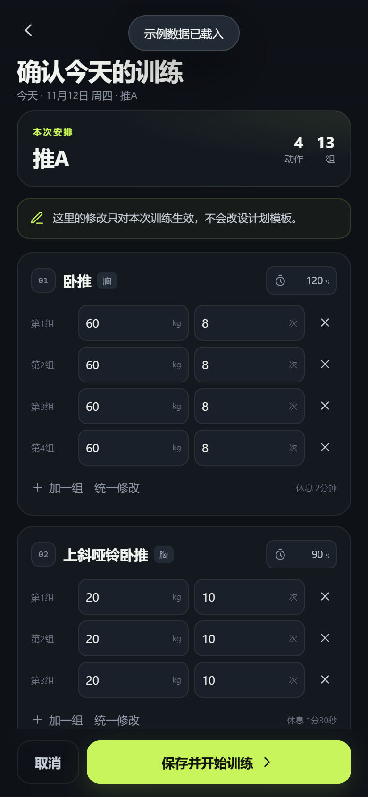

### 未来某天

1. 在日历上点未来日期。
2. 选计划 → 确认目标。
3. 点「保存到日历」。
4. 回到日历，日期格会显示计划名（例如「推A」）。
5. 到那天点该日期，再「开始训练」。

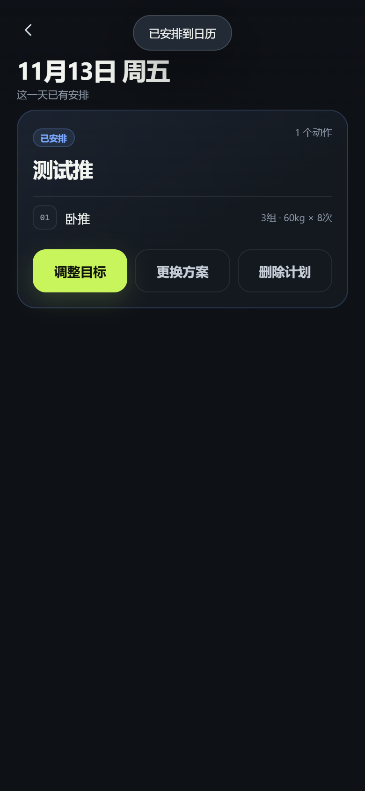

### 更换/调整某天

- 当天页可以「更换方案」「调整目标」「删除计划」。
- 已完成的训练记录不受影响。

---

## 4. 开始训练

确认页点「保存并开始训练」后，全局训练计时开始。

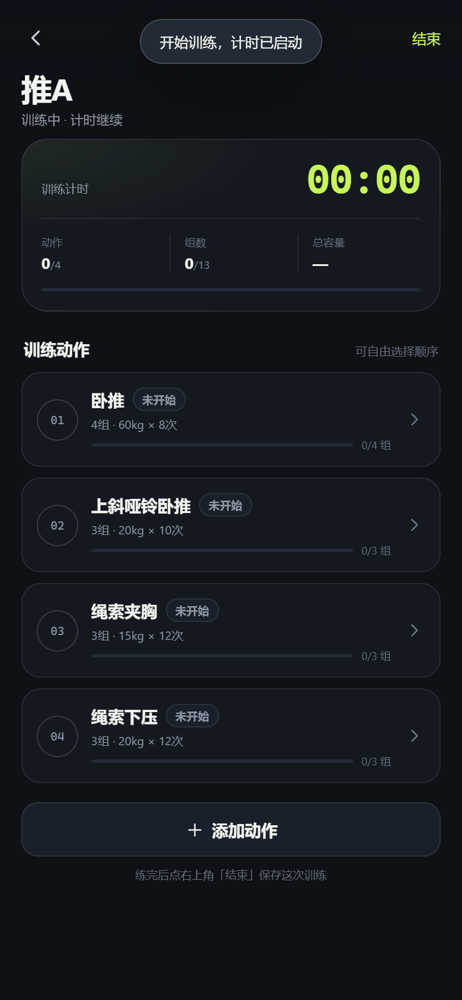

- 动作按计划顺序排列，但**可以自由选择先练哪个**。
- 每张动作卡显示目标（组数、重量、次数）和完成进度。
- 点动作卡进入该动作的组列表。
- 底部「添加动作」可以临时加练。
- 练完后点右上角「结束」保存；离开训练页时，其他页面底部会出现「训练中」悬浮条，点它可返回。

---

## 5. 记录每一组

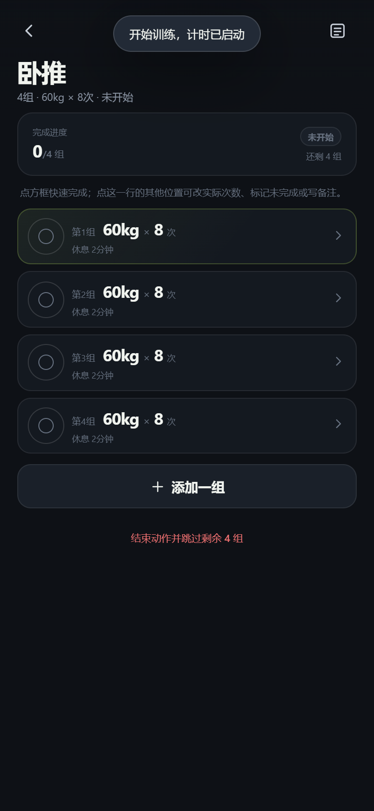

- **点方框**：按目标重量/次数记录为完成 ✔，并立即开始组间休息倒计时。
- **点这一行的其他位置**：打开本组详情，可以：
  - 改成「完成」
  - 改成「未完成」，填写实际完成次数和重量
  - 改成「跳过」
  - 写备注，例如「肩膀有点紧」「重量偏大」；也可点快捷标签
- **添加一组**：如果临时多做一组。
- **结束动作并跳过剩余组**：提前结束这个动作。
- 所有组都处理完后，动作会自动标记完成，并出现「返回动作列表」。

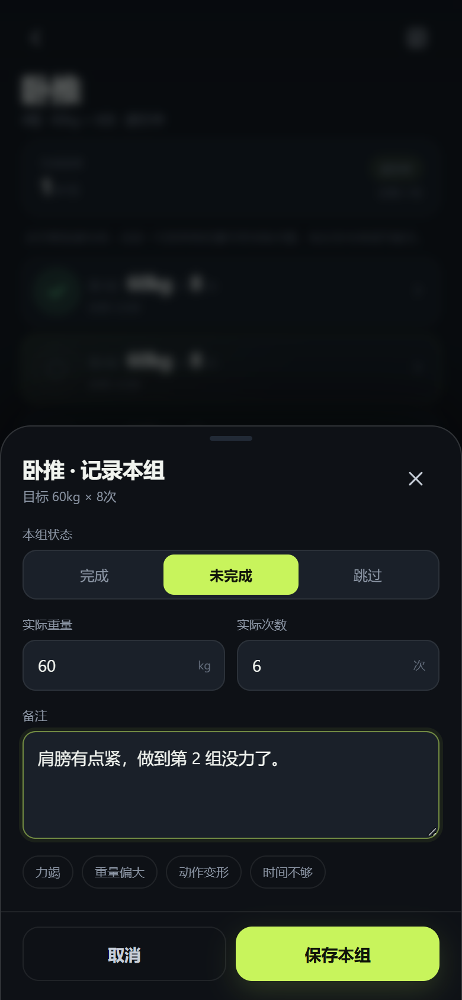

### 组状态说明

| 状态 | 含义 |
| --- | --- |
| □ 空方框 | 还没记录 |
| ✔ 绿色 | 按目标完成 |
| ◐ / − 琥珀色 | 未完成，已记录实际次数 |
| 灰色/虚线 | 跳过 |
| 数字带 `*` | 历史记录里表示该组未完成 |

---

## 6. 组间休息提醒

完成一组后，屏幕下方出现休息条：

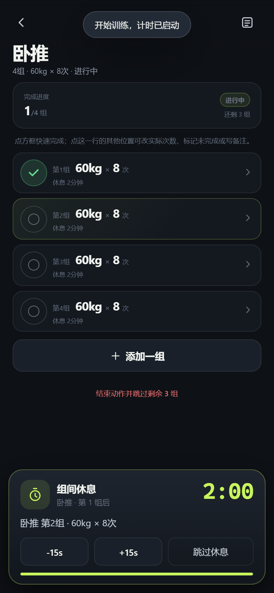

- 显示剩余时间、下一组/下一动作。
- `-15` / `+15`：缩短或延长。
- `跳过`：不等了，直接开始下一组。
- 时间到后显示「休息结束」，可以点「知道了」关闭。
- 提前完成下一组会自动取消上一次提醒。
- PC 浏览器上需要允许通知；真正锁屏提醒在 Android APK 上会更可靠。

如果休息条挡住了内容，向上滚动即可；倒计时条会固定在底部。

---

## 7. 结束训练与查看记录

### 结束

1. 点训练页右上角「结束」。
2. 可以填写本次训练备注。
3. 未处理的组会提示「结束后标记为跳过」。
4. 点「确认结束」。

训练结束后会进入当天记录页。

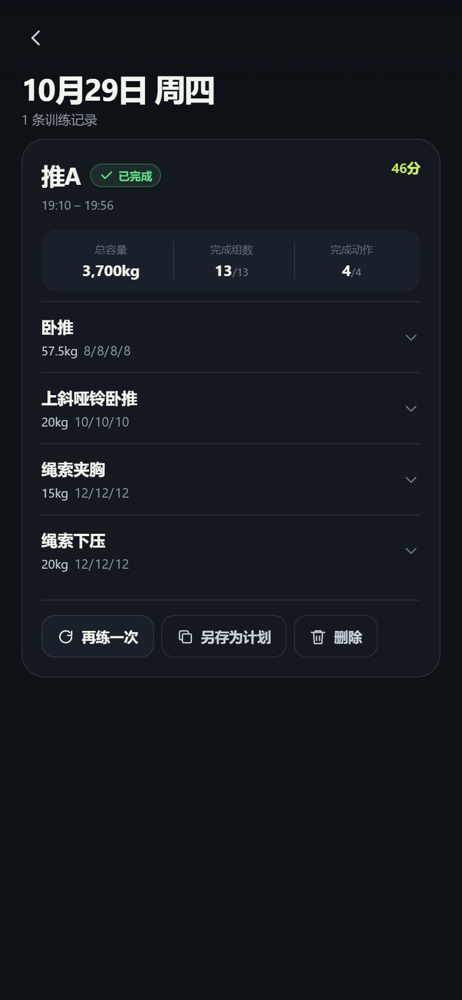

记录页显示：

- 方案名和「已完成」状态
- 训练时间段和总时长
- 总容量、完成组数、完成动作数
- 每个动作的重量和次数序列，例如：
  - `引体向上 自重 5/5/5/5/5`
  - `杠铃划船 40kg 10/10/10`
- 点动作展开：每组实际重量/次数、状态、备注
- 操作：再练一次、另存为计划、删除记录

### 查看历史

- 日历上已完成日期带 ✔ 和计划名。
- 点过去日期即可看当天全部记录。
- 日历标记：蓝色 = 已安排，绿色 = 已完成，荧光绿 = 训练中。
- 今天条会显示今天是否已安排/已完成，并提供快捷入口。

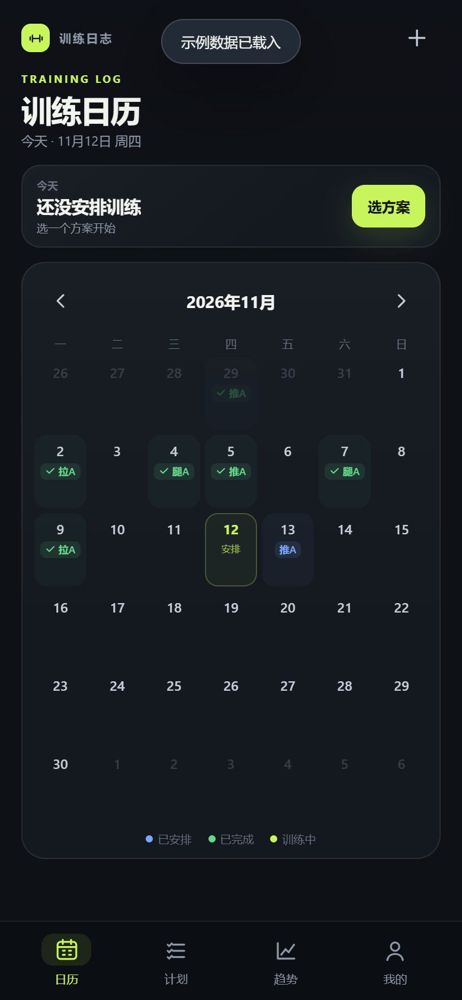

---

## 8. 趋势

底部「趋势」，默认先显示「身体」，第二个是「动作」。

### 身体数据

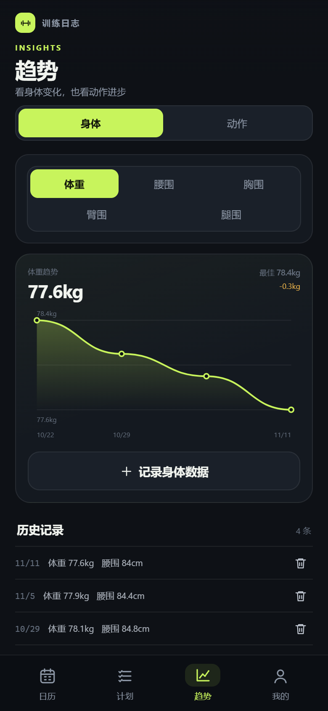

- 切换体重/腰围/胸围/臂围/腿围。
- 点「记录身体数据」填写日期和数值，可只填一项。
- 历史记录点一行可编辑；右侧垃圾桶可删除。
- 同一天多次记录时，趋势取当天最新一条。

### 动作趋势

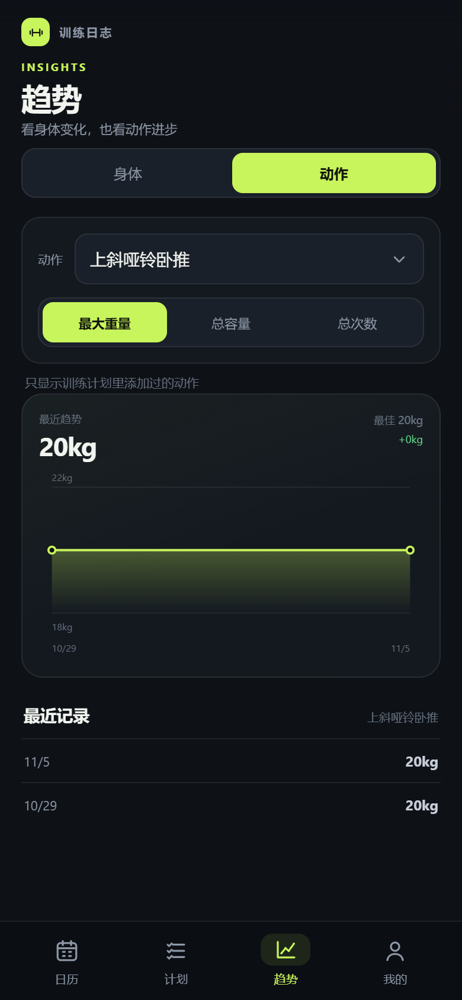

- 动作下拉**只列出训练计划里添加过的动作**，不会出现无关动作。
- 示例计划在未编辑、未开始前不会计入；开始一次示例训练、或编辑并保存示例计划后，它就会算作你的计划并出现。
- 选择动作，切换「最大重量 / 总容量 / 总次数」。
- 下方「最近记录」显示最近几次数据。
- 自重动作没有负重数据时，最大重量图会提示切换「总次数」。

---

## 9. 设置与备份

底部「我的」。

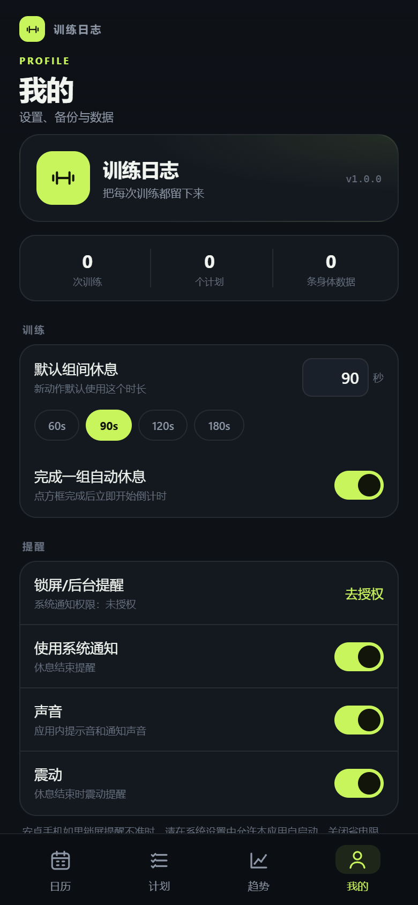

### 训练

- **默认组间休息**：新动作的默认休息秒数，右侧可直接改数值；下面有 60/90/120/180 秒快捷按钮。
- **完成一组自动休息**：开启后点方框完成就自动倒计时；关闭后不自动开始。

### 提醒

- **锁屏/后台提醒**：显示系统通知权限，点「去授权」申请。
- **使用系统通知**：关闭后不再发系统通知，但应用内倒计时仍可用。
- **声音 / 震动**：控制应用内提示和通知渠道选择。

### 数据

- **导出备份**：下载 JSON，包含计划、训练、身体数据、自建动作和设置。
- **导入备份**：
  - 合并导入：保留现有数据，只添加备份中不存在的记录。
  - 覆盖导入：清空现有计划/训练/身体数据，再导入。
- **载入示例数据**：添加 3 个示例计划、几条历史和身体数据，便于体验。
- **清空所有数据**：不可撤销，建议先导出。
- 页面底部显示本地存储占用。

---

## 10. 通知与权限

### PC 浏览器

- 第一次开始训练时会请求浏览器通知权限。
- 如果拒绝了，可以在浏览器地址栏/站点设置里重新允许。
- 浏览器标签页关闭后，网页版无法保证提醒；此时组间休息的应用内倒计时仍可用，但关掉页面就收不到。

### Android APK

- APK 已构建并签名，安装路径见 1.1。
- Android 13+ 需要允许通知；首次开始训练时会弹系统权限请求。
- 部分品牌（小米/OPPO/vivo/荣耀等）需要额外允许自启动、关闭省电限制，锁屏提醒才稳定。
- 通知的声音/震动由系统通知渠道「休息提醒」控制，也可以在系统设置里单独调整。
- 当前使用非精确闹钟方式调度提醒，极端省电状态下可能有少许延迟；应用内倒计时始终有效。
- 建议装好后先做一次 10-20 秒的短休息实测，确认锁屏/通知栏能收到「休息结束」。

---

## 11. 常见问题

**Q：打开后什么都没有？**
A：第一次使用数据为空。到「计划」载入示例数据，或新建计划。

**Q：为什么动作记录里显示 `—`？**
A：该组未完成/被跳过，或训练结束时仍未处理，系统会自动标记为跳过。

**Q：为什么总容量是 `—`？**
A：这次训练只有自重动作，没有负重容量。可以点动作展开看实际次数，或到趋势看「总次数」。

**Q：为什么锁屏没有提醒？**
A：先确认通知权限；PC 网页版关掉标签页后不可靠；Android 还要检查系统省电限制和通知渠道。应用内休息条始终有效。

**Q：计划改了，为什么日历里的计划没变？**
A：排到日历的是快照。改计划模板不会改已排日期；需要到对应日期「调整目标」或「更换方案」。

**Q：一天能练两次吗？**
A：可以保留多条已完成记录。当天页右上角「+」可再选方案；或从记录里「再练一次」。已排的计划会被新的安排替换。

**Q：换手机 / 装 APK 后数据怎么办？**
A：在 PC 测试版「我的 → 导出备份」，把 JSON 发到手机，在 APK「我的 → 导入备份」中选择合并或覆盖。

**Q：数据存在哪？会丢吗？**
A：保存在本机 WebView/浏览器的 localStorage。卸载 App、清除浏览器站点数据会丢失。请定期导出备份。

**Q：为什么训练计时停了？**
A：训练计时根据开始/结束时间计算，切后台不会停；但 App 被系统彻底杀掉后，重新打开会从原开始时间继续，不会丢失。

**Q：为什么有些按钮/文字很小？**
A：PC 浏览器窗口可能过窄或缩放；把窗口宽度调到 500px 以上，或使用浏览器 100% 缩放。手机端按 390px 左右设计。

---

## 12. 当前版本限制

- 仅 Android 手机端计划（未做 iOS）。
- 数据本地存储，无账号/云同步。
- 计划模板支持手动排到某天，暂不支持“每周一/三/五自动循环”。
- 训练中可自由选动作顺序，但暂不支持拖动排序/超级组。
- APK 已构建并签名（`release/WorkoutLog-v1.0.0.apk`）；真机安装兼容性、锁屏通知和厂商省电策略仍需实际验证。
- 动作趋势只统计训练计划里的动作，示例计划在未编辑/未开始前不计入。
